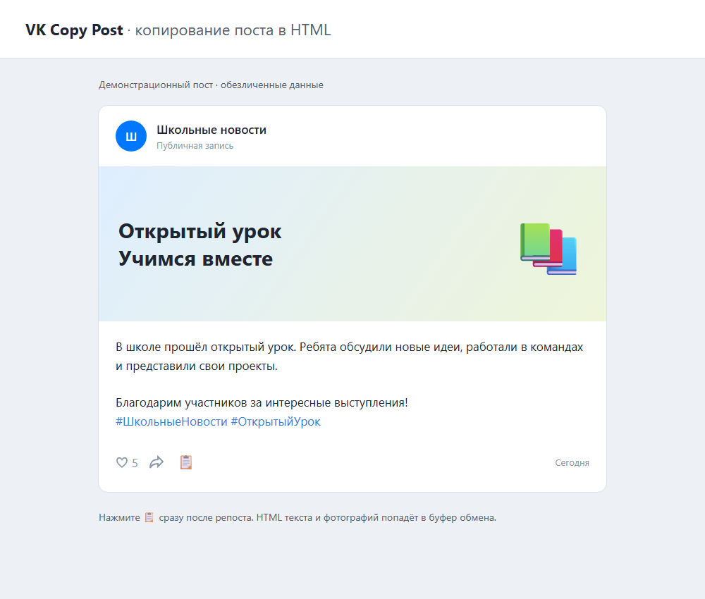
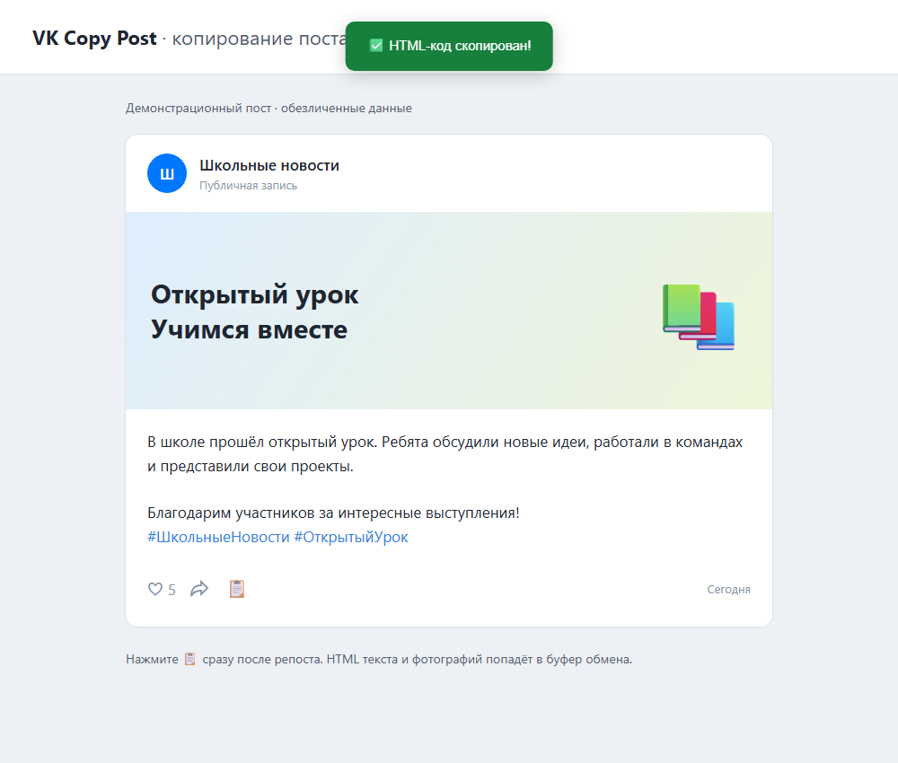
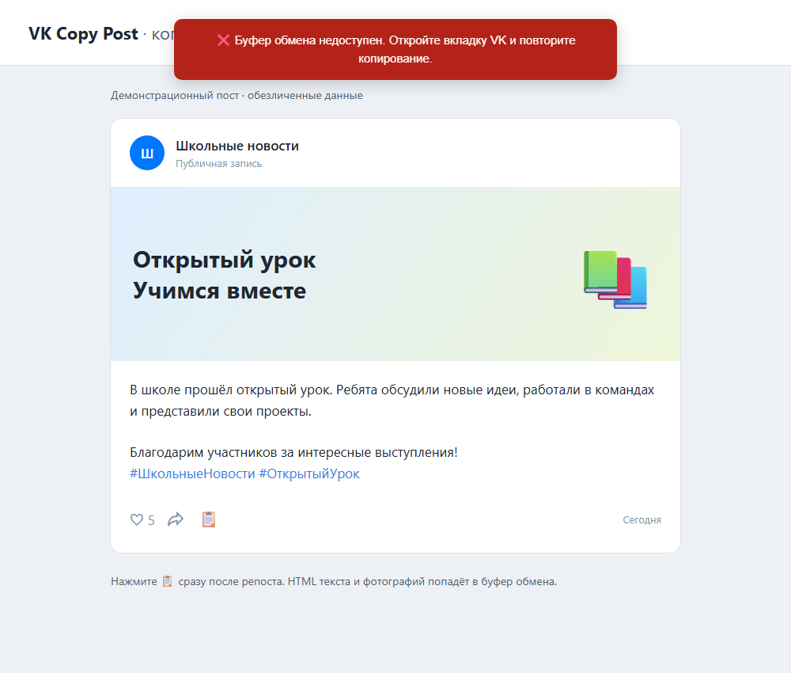
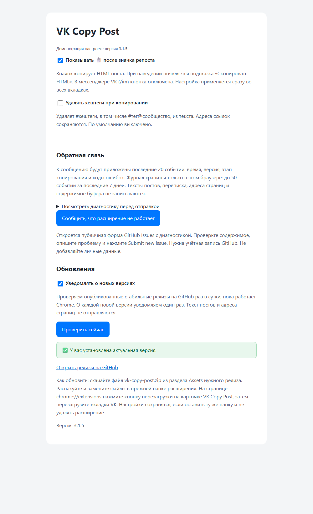

# 📋 VK Copy Post

**Копируйте посты ВКонтакте в HTML одним нажатием.** Расширение собирает текст, ссылки и фотографии записи для вставки в HTML-редактор сайта школы.

[Скачать расширение](https://github.com/ToxaSM/vk-copy-post/releases/latest/download/vk-copy-post.zip) · [Все версии](https://github.com/ToxaSM/vk-copy-post/releases) · [Сообщить о проблеме](https://github.com/ToxaSM/vk-copy-post/issues)

## Что умеет расширение

- Добавляет значок **📋 сразу после репоста** в нижней строке поста.
- Копирует HTML текста и фотографий, сохраняет ссылки и переносы строк.
- Раскрывает текст через «Показать ещё» перед копированием.
- Удаляет хештеги по желанию: настройка включается отдельно.
- Сообщает о новых версиях на GitHub и даёт ссылку для скачивания.
- Помогает отправить автору описание проблемы с диагностикой.

Работает на `vk.ru` и `vk.com` в Google Chrome. В разделе сообщений `/im` кнопка отключена.

## Как выглядит

Скриншоты сделаны на демонстрационном посте и обезличенных данных с использованием интерфейса расширения.

**Кнопка копирования — справа от значка репоста:**

Успех отображается зелёным уведомлением сверху по центру, ошибка — красным:

| ✅ Успешное копирование | ❌ Ошибка копирования |
| --- | --- |
|  |  |

## Установка в Chrome

1. **[Скачайте vk-copy-post.zip](https://github.com/ToxaSM/vk-copy-post/releases/latest/download/vk-copy-post.zip)** из последнего релиза. На странице релиза этот файл находится в разделе **Assets**.
2. Распакуйте архив в постоянную папку, например `Документы\VK Copy Post`. В выбранной папке должен лежать файл **manifest.json**.
3. Вставьте **`chrome://extensions`** в адресную строку Chrome и откройте страницу расширений.
4. В правом верхнем углу включите **«Режим разработчика»**.
5. Нажмите **«Загрузить распакованное расширение»** и выберите папку с `manifest.json`.
6. Откройте или перезагрузите страницу VK. Значок **📋** появится после репоста у распознанных постов.

Сохраните папку расширения: Chrome использует файлы из неё при работе. Файлы `Source code (zip)` и `Source code (tar.gz)` предназначены для разработки; готовая сборка для установки — **vk-copy-post.zip**.

Чтобы закрепить расширение на панели Chrome, нажмите значок пазла справа от адресной строки и булавку рядом с **[DNO_IT] VK Copy Post**.

## Как скопировать пост

1. Найдите нужную запись VK и прокрутите до нижней строки с реакциями и репостом.
2. Нажмите **📋** после значка репоста. При наведении появляется подсказка **«Скопировать HTML»**.
3. Дождитесь зелёного сообщения **«HTML-код скопирован!»**.
4. Откройте редактор сайта, переключитесь в режим **HTML / исходного кода** и вставьте результат через **Ctrl+V**.

Также можно нажать иконку расширения на панели Chrome: скопируется первый видимый распознанный пост на текущей странице.

Фотографии вставляются в HTML ссылками на изображения VK; отдельные файлы фотографий не скачиваются. При копировании удаляются эмодзи из текста записи. Расширение не публикует материал на сайте — вставку и сохранение выполняет пользователь.

## Настройки

Нажмите **правой кнопкой по иконке расширения → «Параметры»**. Также страницу настроек можно открыть через карточку расширения на `chrome://extensions`.

| Настройка | Что делает | По умолчанию |
| --- | --- | --- |
| Показывать 📋 после значка репоста | Показывает или сразу скрывает кнопку во всех открытых вкладках VK | Включена |
| Удалять хештеги при копировании | Убирает `#хештеги`, в том числе `#тег@сообщество`, сохраняя адреса ссылок | Выключена |
| Уведомлять о новых версиях | Включает фоновую проверку GitHub Releases и уведомления | Включена |

<strong>Скриншот страницы настроек</strong>

## Как обновить расширение

Расширение уведомляет о новых версиях, а замену файлов пользователь выполняет вручную.

1. Откройте релиз из уведомления или **[скачайте актуальный vk-copy-post.zip](https://github.com/ToxaSM/vk-copy-post/releases/latest/download/vk-copy-post.zip)**.
2. Распакуйте архив и **замените файлы в прежней папке расширения**.
3. Откройте **`chrome://extensions`**.
4. На карточке **[DNO_IT] VK Copy Post** нажмите **значок перезагрузки ↻**.
5. Перезагрузите открытые вкладки VK и проверьте номер версии на карточке расширения или в его настройках.

Для сохранения настроек оставьте ту же папку и обновляйте расширение без удаления его из Chrome.

### Проверка новых версий

В настройках нажмите **«Проверить сейчас»**. Результат появится в цветном блоке:

- ✅ **Зелёный** — установлена актуальная версия.
- 🆕 **Синий** — доступна новая версия; рядом появится ссылка на релиз.
- 📦 **Жёлтый** — опубликованных релизов пока нет.
- ❌ **Красный** — проверка не удалась; проверьте подключение и попробуйте позже.

Фоновая проверка выполняется не чаще раза в сутки, пока работает Chrome. О каждой новой версии показывается одно системное уведомление. Проверяются стабильные **GitHub Releases**; обычные коммиты, теги без релиза и предварительные версии не вызывают уведомлений.

Если у вас версия **3.0**, обновите её вручную: в ней ещё нет функции уведомлений.

## Если что-то не работает

**Нет значка 📋:**

1. Убедитесь, что расширение включено в `chrome://extensions`.
2. Проверьте настройку **«Показывать 📋 после значка репоста»**.
3. После установки или обновления перезагрузите вкладку VK.
4. Откройте пост в ленте или сообществе: мессенджер `/im` исключён.

**Не копируется HTML:** откройте вкладку VK на переднем плане, повторите попытку и проверьте текст красного уведомления.

Если проблема остаётся:

1. Повторите действие, на котором возникает ошибка.
2. Откройте настройки расширения.
3. При желании раскройте **«Посмотреть диагностику перед отправкой»** и нажмите **«Обновить журнал»**.
4. Нажмите **«Сообщить, что расширение не работает»**.
5. В открывшейся форме GitHub опишите шаги и результат, проверьте диагностику и отправьте сообщение. Для отправки нужна учётная запись GitHub.

Сообщения GitHub Issues публичные. Добавляйте только те данные, которые готовы опубликовать.

## Какие данные используются

- Текст поста и фотографии обрабатываются на странице; результат записывается в буфер обмена.
- В диагностике сохраняются время, версия, этап выполнения и фиксированные коды событий. Тексты постов, переписка, адреса страниц и буфер обмена в журнал не попадают.
- Журнал ограничен 50 событиями; в отчёте используются события за последние 7 дней, в форму сообщения добавляются последние 20.
- Диагностика хранится локально. Отправка автору происходит после отправки формы пользователем.
- Для проверки обновлений запрашиваются метаданные публичного релиза GitHub без токена и cookies. Содержимое VK в запрос не включается; GitHub получает IP-адрес соединения.

## Состав проекта и выпуск

В корне находятся файлы расширения. **README.md** и **docs/screenshots/** содержат инструкцию и иллюстрации; **.github/workflows/release.yml** отвечает за проверку и создание релизов. Установка зависимостей npm не требуется.

GitHub Actions проверяет наличие обязательных файлов и синтаксис JavaScript, затем создаёт **dist/vk-copy-post.zip**. В архив попадают только `manifest.json`, `background.js`, `content.js`, `parser.js`, `diagnostics.js`, `updates.js`, `options.html`, `options.css`, `options.js` и `icon.png`. Инструкция, скриншоты и конфигурация GitHub Actions в расширение не включаются.

Для выпуска увеличьте версию в **manifest.json** и отправьте тег `v<version>`. Релиз также создаётся после успешной сборки коммита в `main`, если его сообщение начинается с `Release v`. Workflow публикует **vk-copy-post.zip** в GitHub Releases. Изменения только в документации и структуре репозитория не требуют новой версии расширения.
